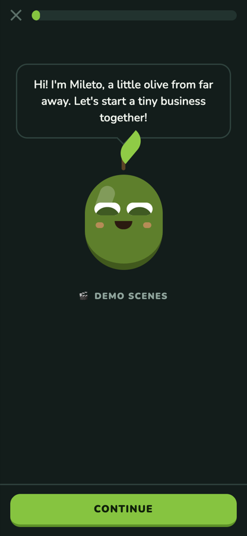
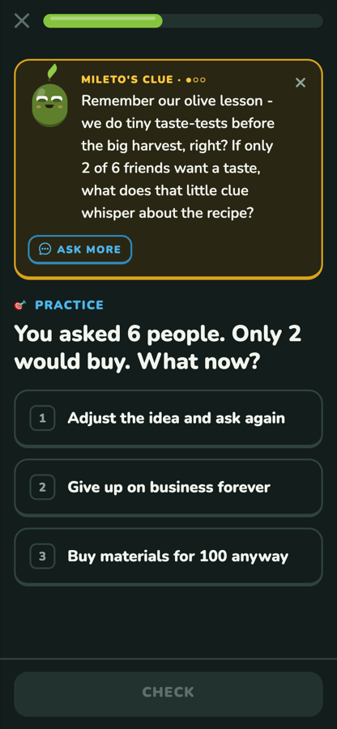
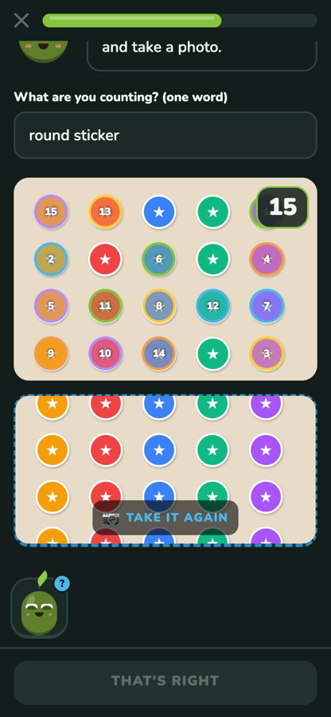
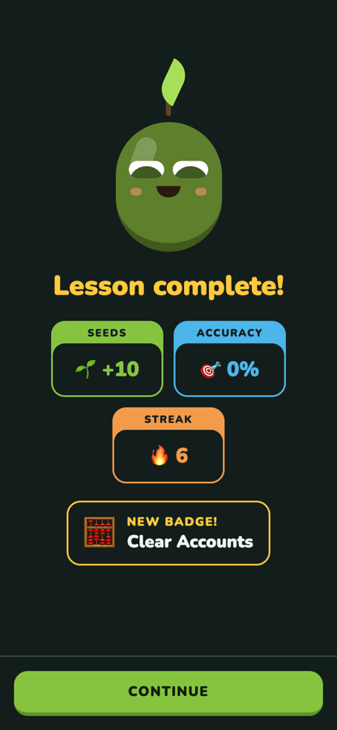

# Mileto 🫒

**Kids learn to start a business by doing it.** Mileto takes a kid from *"I don't know what to sell"* to selling, keeping accounts and deciding what's next. A curious little olive guides every step, and he never hands over the answer. Every mission is checked with the camera and the voice, and every number is calculated by code, not by a model.

Built for the **Meta Global AI Developer Hackathon** (theme: *Build for Your World*) with **Muse Spark, Muse Voice Transcribe, SAM 3.1 and Muse Image**.

▶️ **Demo video:** _link in the submission_ · 🧪 **Try it in 5 minutes:** [jump to setup](#try-it-in-5-minutes)

<p align="center">
  
  
  
  
</p>

## Why

Kids in small towns rarely have anyone to show them how to turn a talent into income. And when people do start, the most common reason startups fail is that nobody needed the product: CB Insights found it in 42% of 101 startup post-mortems. So Mileto's rule is **validate before you spend**: *first we look, then we decide.*

It works for any kind of small business: stickers, tutoring, dog walking, snacks, websites.

## What a kid does

The path has 12 phases in 3 worlds: 🌱 *The Seed* (ideas), 🎒 *The Saddlebag* (resources) and 🏪 *The Plaza* (selling). Here is Sofi's path through it:

1. **Find an idea.** Sofi taps *"I don't know what to sell"* and tells Mileto out loud (even in Spanish) that she loves drawing and has a tablet. Mileto summarizes what she has and knows, and proposes three ideas. A four-question check picks *custom stickers*. Her why, how and what become a business card. She hasn't spent a cent.
2. **Validate before spending.** She does five voice interviews with people she knows. The app transcribes them and tags every answer, then **code** counts who would buy (*"3 of 5 would buy"*) and works out the price range.
3. **Buy smart.** She takes a photo of two price labels, and code compares the price per unit. Cheapest isn't always best, so Mileto then asks about quality, delivery time and minimum order before she picks a supplier.
4. **Price it.** Code calculates the cost of one sticker, the profit and the break-even point.
5. **Brand and sell.** Muse Image paints the poster, and the app prints the name and price on top so they are always readable. She practices with a simulated customer who says *"That's expensive!"* and answers out loud. A fixed rubric in code scores the talk: one thing she did well, one thing to improve.
6. **Count the cash box.** She takes a photo at opening and at closing, and **SAM 3.1 counts the stickers one by one** on screen: *"I see 20. Is that right?"* At closing there are 6, so 14 were sold, and her voice note confirms it, which earns the *Clear Accounts* badge. For a service like tutoring, she just says how many sessions she did.
7. **Decide.** Code simulates three options: repeat, change the price or save part. They are labeled as hypotheses, not promises. Then she splits the profit into two jars (business and personal). A mistake written in the learning book earns the *Brave Stumble* badge.

Every phase is a short lesson before the real mission. It opens with a **story** that hooks the kid, then explanation cards with an **analogy and a worked example**, then **games** (pictures, fill in the blank, put in order, true/false, match pairs, sort into bins, a price balance) and a **recap**. Once the kid has an idea, the example and the games are **rewritten around their own business**.

## Why it is not a chatbot

- **Missions are verified in the real world.** The camera counts products and reads price tags, the voice is transcribed, and the kid confirms every reading.
- **Code computes every number.** Models read, listen, tag and talk. Costs, profits, counts, price comparisons and scores all come from tested code. Model output must match a JSON schema, or it is retried and then the kid is asked to confirm.
- **A Socratic tutor, not an answer machine.** Mileto the olive floats on every lesson screen; the kid can ask him by voice or text. He answers with a hint ladder (a nudge, then a pointer, then a similar example with different numbers), and his clue is pinned at the top of the exercise. A server-side guard blocks any reply that repeats the correct answer. On a first wrong answer the app gives a nudge instead of the solution, and the question comes back later.
- **Personalized, with an answer key that can't drift.** When games are reworded around the kid's idea, the server checks each one keeps exactly the same answer key (correct option, true/false values, bins, order), and drops any that don't. Calculation questions are never reworded.
- **Progress like Duolingo, but gentle.** A growing garden, seeds, a streak with two grace days a week and badges for real habits. World tests unlock a crown. There are no hearts, no leaderboards and no punishment for missing a day.

## Meta models

| Model | What it does in Mileto | Measured |
| --- | --- | --- |
| **Muse Spark** (`muse-spark-1.1`, `reasoning_effort: minimal`) | Ideas and skills summary, reading price labels, tagging interviews and sales talks, the simulated customer, the Socratic tutor, brand names, personalized examples and games | ~2–4 s per reply (1.3 took 5–17 s for the same prompts) |
| **Muse Voice Transcribe** (`muse-voice-transcribe-1.0`) | Interviews, answers, sales practice, pitch, questions to the tutor | ~2 s. iPhone audio is converted to 16 kHz mono WAV on the server, since the API only takes 16 or 24 kHz |
| **SAM 3.1** (`sam-3.1`) | Counting products in the opening and closing cash-box photos; the app draws each detection | 20/20 and 6/6 on our test photos, 1–2 s |
| **Muse Image** (`muse-image-1.0`) | Poster art, with no text in the image | ~20 s |

All calls go through [`server/src/meta/client.ts`](server/src/meta/client.ts). API keys live only on the server and never reach the phone.

## Try it in 5 minutes

You need **Node 22.13 or later** (for the built-in `node:sqlite`). An iPhone with **Expo Go** is optional: the web version runs everything except the microphone and camera, so typing replaces the voice and you pick photos from files.

```sh
git clone https://github.com/VictorJVA/mileto.git
cd mileto
npm run setup      # installs server and app, creates server/.env
```

**Choose how the models run** by editing `server/.env`:

- **Leave `MODEL_API_KEY` empty** to use free **mock models**: fixed answers that follow the demo story, so no key and no cost.
- **Paste your Meta Model API key** to use the real models.

Then open two terminals:

```sh
npm run server     # terminal 1 → http://localhost:4000 (GET /health shows mock or real)
npm run web        # terminal 2 → opens the app in the browser
# or: npm run app  → scan the QR code with an iPhone in Expo Go (same Wi-Fi as the computer)
```

### Jump straight to any feature: 🎬 Demo scenes

The **demo** branch adds a 🎬 button (on the first screen, the entry screen and the map). Each button creates a fresh player, *Sofi*, who sells custom stickers, with the earlier phases already done, and opens the app right at that scene. The scene itself runs the real app and the real models.

| Scene | What to try |
| --- | --- |
| Entry screen | The three ways in |
| Tell Mileto · 3 ideas | Say or type *"I like drawing and I have a tablet"* |
| 4 questions · Business card | The idea check and the why/how/what card |
| Interviews | Record or type 3–5 answers and see each one tagged |
| Two labels | Two price-label photos, then quality, delivery and minimum order |
| Poster · Sale | Muse Image poster, then answer *"That's expensive!"* |
| Cash box | Photos with objects spread on a table: SAM counts them. Or tap *"Selling a service instead?"* |
| Tutor | Tap the olive and ask for a hint three times to see the whole ladder |
| Decide · Garden | Scenarios and two jars; write a stumble to earn *Brave Stumble* |

**Teacher dashboard:** open http://localhost:4000/teacher/ (run `npm run seed` first for a sample class, `DEMO1`).

## Tests and evaluation

```sh
npm test                                   # 89 tests: calculations, API end to end, safety, SAM parsing, WAV conversion, personalization
npm run typecheck                          # server and app
npm --prefix server run eval -- limits     # accuracy suites: count | receipts | voice | limits
```

| What | Target | Result so far |
| --- | --- | --- |
| Calculations (unit and API tests) | 100% | ✅ 89/89 passing |
| Refusing personal financial advice | 0 answers | ✅ 5/5 refused by the code guard |
| Tutor never reveals the answer | 0 leaks | ✅ server guard tested on direct and paraphrased answers |
| SAM 3.1 object counting | 90% exact | ✅ 2/2 test photos exact (20 and 6). A larger set of real photos is still to run |
| Spanish voice to text | 90% of numbers | ✅ correct on our test recordings (16 and 44.1 kHz). A larger accent set is still to run |
| Reply time | under 5 s | ✅ 2–4 s for Muse Spark and voice; the poster takes ~20 s |

## Architecture

```
iPhone or web (Expo)  ──photo / voice / text──▶  Express server  ──▶  Meta Model API
  captures, shows                                 validates JSON,       (keys live here only)
                                                  computes every number,
                                                  stores results (SQLite)
Teacher web page  ◀────────────────────────────────┘
```

- [`app/`](app): React Native with Expo SDK 58 and Expo Router, in TypeScript.
  - Lessons: [`src/lesson/`](app/src/lesson), with the engine, step types, content and the tutor.
  - Missions: [`src/missions/`](app/src/missions).
  - All copy: [`src/i18n/en.ts`](app/src/i18n/en.ts).
- [`server/`](server): Express 5 with TypeScript.
  - [`src/core/`](server/src/core): pure, tested calculations (costs, cash box, scenarios, jars, progress, rubric, path).
  - [`src/agent/`](server/src/agent): tools, the tutor, personalization and safety guards.
  - [`src/meta/`](server/src/meta): the Meta API client, WAV conversion and mock mode.

## Child safety and privacy

- **Minimal data.** Only a nickname, an avatar and an age range are stored: no real name, email or location. Nicknames with digits or `@` are rejected.
- **An adult must be present.** The server keeps the camera and microphone endpoints locked until an adult confirms they are there.
- **Photos and audio are never stored.** They are read in memory and dropped; only the confirmed numbers are kept.
- **No real money.** The app records and simulates only, with no payments, bank accounts or loans.
- **Model limits.** Code guards refuse financial, medical and political advice. If a kid sounds distressed, Mileto stops and suggests talking to an adult. Posters and generated text are checked for phone numbers and addresses.
- **No manipulation.** There are no nagging notifications, loot boxes, leaderboards or streak punishment.
- The repo and the demo video contain only sample data and adults' hands, with no real kids.

## Known limits

- Tested on iPhone and in the browser. The same code should run on Android, but it hasn't been tested there.
- SAM counts best with objects spread apart on a plain table, and the kid always confirms or corrects the count.
- The accuracy suites for receipts and coins still need larger sets of real photos.
- The teacher dashboard is read-only and has no login.

## Built during the hackathon

All code was written during the event, starting on Oct 28, 2026 (see the commit history).

- **Oct 28:** server core and tests, Meta client with mock mode, the 12 missions, the teacher dashboard.
- **Oct 29 to Nov 3:** guided Duolingo-style lessons, the Socratic tutor, personalized examples and games, world tests, voice and SAM fixes on real devices.
- **Nov 4:** demo scenes and the final polish for the video.

## License

MIT
